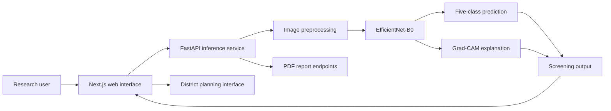

<div align="center">

# RetinaScope AI

**Explainable retinal screening intelligence**

AI-powered diabetic retinopathy screening and district-level healthcare resource planning.

A research and demonstration platform by **Team Shadow**.

[**Live Platform**](https://retina-scope-final.vercel.app/) · [Research Methodology](https://retina-scope-final.vercel.app/methodology) · [Report an Issue](https://github.com/Harshit0717-cpu/retinaScope-Final/issues)


</div>

---

## Overview

RetinaScope AI brings retinal image classification, visual model explanations and screening resource planning into a single web-based research workspace. It explores how machine learning can support the review of retinal fundus photographs while keeping model limitations and professional oversight visible.

The application pairs a Next.js interface with a FastAPI inference service and an EfficientNet-B0 model. Beyond individual image analysis, the platform includes a district-level planning layer for exploring screening demand, estimated capacity and potential resource gaps.

> [!IMPORTANT]
> RetinaScope AI is a research and demonstration prototype. It is not a medical device, a validated clinical diagnostic system or a replacement for professional eye examination. Do not upload identifiable patient data to the public demonstration.

## Live deployment

| Resource | Access |
| :--- | :--- |
| Screening workspace | [retina-scope-final.vercel.app](https://retina-scope-final.vercel.app/) |
| Research methodology and limitations | [Read the methodology](https://retina-scope-final.vercel.app/methodology) |
| Source repository | [GitHub](https://github.com/Harshit0717-cpu/retinaScope-Final) |
| Frontend hosting | Vercel |
| Inference service hosting | Railway |

## Core capabilities

| Capability | Description |
| :--- | :--- |
| **Retinal image classification** | EfficientNet-B0 predicts one of five diabetic retinopathy severity classes from a fundus image. |
| **Dual-eye analysis** | Supports independent review and comparison of left-eye and right-eye images. |
| **Explainable AI** | Grad-CAM highlights image regions that contributed to the model prediction. |
| **Referable DR flag** | The inference service flags predicted grades 2–4 for research workflow demonstration. |
| **Screening reports** | Backend endpoints generate single-eye and dual-eye PDF reports from supplied case details and screening outputs. |
| **District-level planning** | Explores estimated screening demand, capacity, gaps and priority categories using project data. |
| **Interactive interface** | Responsive research workspace with light/dark themes and accessible methodology documentation. |

## System architecture



The frontend is deployed separately from the CPU-based inference service. Model weights remain on the backend; image analysis is performed through API requests.

## Machine learning methodology

| Component | Implementation |
| :--- | :--- |
| Input | Retinal fundus photographs (JPG, JPEG, PNG) |
| Preprocessing | Resize to 224 × 224, CLAHE, light denoising and normalization |
| Model | EfficientNet-B0, implemented using PyTorch and timm |
| Output | Five-class DR classification, class scores and referable DR flag |
| Explainability | Gradient-weighted Class Activation Mapping (Grad-CAM) |
| Runtime | CPU inference with the saved model checkpoint |

### Severity classification

| Grade | Model output |
| :---: | :--- |
| 0 | No DR |
| 1 | Mild DR |
| 2 | Moderate DR |
| 3 | Severe DR |
| 4 | Proliferative DR |

### Internal validation

| Metric | Project-reported result |
| :--- | ---: |
| Validation accuracy | 80.08% |
| Macro F1 | 0.6486 |

These values are reported in the project's [research methodology](https://retina-scope-final.vercel.app/methodology). They describe internal validation, not independent clinical performance. External testing, calibration, image-quality evaluation and prospective clinical assessment remain necessary. Model confidence is not a calibrated probability of disease; Grad-CAM is not a verified lesion annotation.

## Technology stack

| Layer | Technologies |
| :--- | :--- |
| Frontend | Next.js, React, TypeScript, Tailwind CSS, Motion, Lenis |
| Backend | Python 3.11, FastAPI, Uvicorn |
| Machine learning | PyTorch, torchvision, timm, OpenCV, NumPy, Pillow |
| Explainability | Grad-CAM |
| Reporting | ReportLab |
| Infrastructure | Docker, Vercel, Railway |

## Repository layout

```text
retinaScope-Final/
├── frontend/                  Next.js application
│   ├── app/                   Pages, styles and SEO metadata
│   ├── lib/                   Frontend API integration
│   └── public/                Static assets and planning data
├── backend/                   FastAPI application
│   ├── main.py                API routes
│   ├── model.py               Model loading and inference setup
│   ├── preprocessing.py       Image preprocessing
│   ├── gradcam.py             Model explanations
│   ├── reports.py             PDF report generation
│   └── district_planning.py   Planning utilities
├── models/                    Saved checkpoints (separate rights review)
├── district_shapes/           Geospatial assets (separate rights review)
├── planning_data.csv          Planning inputs
├── train.py                   Training script
├── train_full.py              Full-training script
├── app.py                     Earlier Streamlit interface
├── Dockerfile                 CPU backend container
├── requirements-backend.txt   Backend dependencies
└── requirements.txt           Additional research dependencies
```

## Local development

Use authorized local model assets and demonstration images only. The current backend expects `models/efficientnet_b0_best.pth` to exist. Review [third-party notices](THIRD_PARTY_NOTICES.md) before obtaining, copying or using any dataset, checkpoint or geospatial asset.

**Prerequisites:** Git, Python 3.11 and a Node.js version supported by the frontend's Next.js release.

### 1. Clone the repository

```bash
git clone https://github.com/Harshit0717-cpu/retinaScope-Final.git
cd retinaScope-Final
```

### 2. Start the inference backend

From the repository root, create and activate a Python virtual environment. On Windows PowerShell:

```powershell
python -m venv .venv
.\.venv\Scripts\Activate.ps1
```

On macOS/Linux, activate with `source .venv/bin/activate` instead. Then install the CPU inference dependencies and start the API:

```bash
python -m pip install --upgrade pip
python -m pip install --index-url https://download.pytorch.org/whl/cpu torch==2.6.0 torchvision==0.21.0
python -m pip install -r requirements-backend.txt
python -m uvicorn backend.main:app --host 127.0.0.1 --port 8000
```

Check `http://127.0.0.1:8000/api/health` and the interactive API documentation at `http://127.0.0.1:8000/docs`.

### 3. Start the web interface

In a separate terminal:

```bash
cd frontend
npm install
```

Create `frontend/.env.local` with:

```dotenv
NEXT_PUBLIC_RETINASCOPE_PREDICT_URL=http://127.0.0.1:8000/api/predict
```

```bash
npm run dev
```

Open `http://localhost:3000`. For a production compilation check, run `npm run build` from the frontend directory.

> The public deployment uses its own environment configuration. Do not replace deployed environment variables with local development URLs.

## API reference

| Method | Endpoint | Purpose |
| :--- | :--- | :--- |
| GET | `/api/health` | Service and model status |
| POST | `/api/predict` | Single-eye inference |
| POST | `/api/predict/dual` | Dual-eye inference |
| POST | `/api/report` | Single-eye PDF report |
| POST | `/api/report/dual` | Dual-eye PDF report |

Request schemas and supported fields are available through the FastAPI `/docs` interface when the backend is running.

## Responsible use and data provenance

- Use authorized, de-identified demonstration images. The live interface sends images to the hosted inference service.
- Treat all predictions and explanations as research outputs requiring professional review.
- District-level planning estimates are illustrative project inputs, not independently verified clinical service inventories.
- The training script references the [APTOS 2019 Blindness Detection](https://www.kaggle.com/competitions/aptos2019-blindness-detection) dataset. Its competition data is governed by separate terms; this repository does not grant redistribution or commercial-use rights to that data.
- Model checkpoints, geospatial files, planning inputs and external assets require separate provenance and rights verification. See [Third-party notices](THIRD_PARTY_NOTICES.md).

## Contributing

Technical feedback and contributions are welcome. Open an issue describing the proposed change, reproducible bug or research limitation before submitting substantial changes. Keep patient information, credentials, restricted datasets and model artifacts without verified redistribution rights out of issues and pull requests.

## License

The original source code and associated original documentation that the copyright holders are authorized to license are offered under the [MIT License](LICENSE). The license does not grant rights to third-party software, datasets, pretrained or trained model weights, geospatial assets, planning data, or other materials whose rights are governed separately. See [Third-party notices](THIRD_PARTY_NOTICES.md). Contributor authorization and artifact-specific redistribution rights should be confirmed before an open-source release announcement.

## Research references

- Tan, M. and Le, Q. V. [EfficientNet: Rethinking Model Scaling for Convolutional Neural Networks](https://proceedings.mlr.press/v97/tan19a.html), ICML 2019.
- Selvaraju, R. R. et al. [Grad-CAM: Visual Explanations from Deep Networks via Gradient-based Localization](https://arxiv.org/abs/1610.02391).
- [APTOS 2019 Blindness Detection — competition and data access](https://www.kaggle.com/competitions/aptos2019-blindness-detection).

---

<div align="center">

**RetinaScope AI · Team Shadow**

Research in explainable retinal intelligence and responsible healthcare technology.

[Explore the platform](https://retina-scope-final.vercel.app/) · [Read the methodology](https://retina-scope-final.vercel.app/methodology)

</div>
